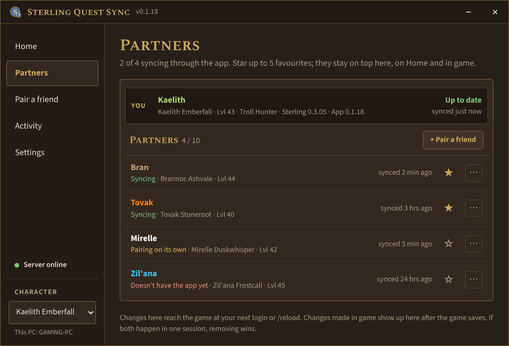
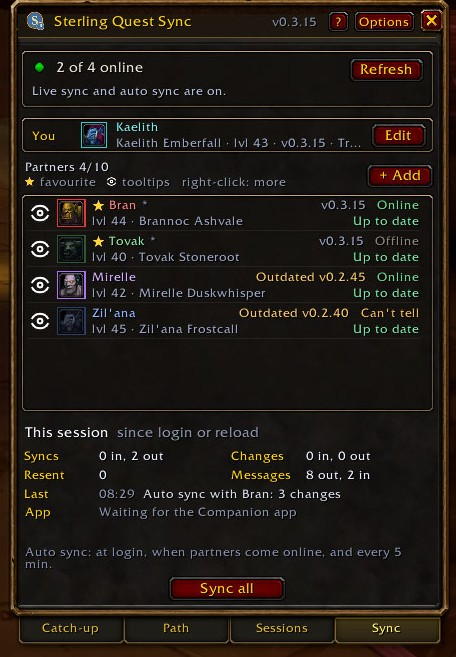

# Sterling Quest Sync

**For use with [Sterling Quest Tracker](https://github.com/SterlingAddons/SterlingQuest).** Start there for the big picture of what Sterling does and how the pieces fit together. This page is all about the desktop app.

**Status:** Still in heavy development and not finished yet. Things are mostly settled now, but big changes can still come with an update.

<p align="center">
  
  
</p>

## What it does

[Sterling Quest Tracker](https://github.com/SterlingAddons/SterlingQuest) already syncs quests live with friends who are online at the same time. This small desktop app covers the rest: when your play times don't overlap, it shares your progress each time the game saves (when you log out or `/reload`), and your friend's app has it waiting before they log in.

- **Syncs on its own.** It notices when the game saves, shares your progress, and hands your friends' progress to Sterling through a small helper add-on. You see it the next time you log in or `/reload`.
- **Pairs on its own.** Friends who are already Sterling partners pair in the app by themselves the next time you're both online. No codes to type.
- **Or pair with a code.** One of you makes a code, the other types it in. Nobody can find you or send you a request.
- **Favourites.** Star up to 5 partners. They stay on top in the app and in game, and starring in one shows up in the other.
- **Keeps Sterling up to date** if you want it to (Settings), and tells you in game when the app has an update.
- **Stays out of the way.** Lives in the tray, works in the background at low priority. Can start with Windows if you turn that on in Settings (off by default).
- **Optional notifications** when a favourite's new progress arrives (off by default).
- **Invite friends** who don't have the app yet: their row on the Partners page has a **Copy invite** button with the download link and setup steps.

Works with WoW Forever. Other WoW versions may work but aren't tested.

<p align="center">
  
</p>
<p align="center"><sub>In game, Sterling's Sync tab shows each partner, favourites on top, and what the app last did.</sub></p>

## Get it

1. Download the newest `SterlingQuestSync_<version>_x64-setup.exe` from [Releases](https://github.com/SterlingAddons/SterlingQuestSync-App/releases/latest).
2. Run it. Windows may show "Windows protected your PC" because the app isn't signed by a paid certificate. Click **More info**, then **Run anyway**.
3. The app finds your WoW folder, offers to install Sterling if it's missing, and makes your account. No email or password.
4. Start WoW, or restart it if it was already open, and log in once. Your character then shows up in the app.

The app updates itself after that (it asks first, unless you turn on automatic updates). Updates are signed, and the app checks the signature before installing.

**Windows:** tested. **Mac and Linux:** not built yet.

<p align="center">
  
  
</p>

## What the partner statuses mean

| Status | What it means |
|---|---|
| **Up to date** (green) | You have their latest progress, and it's in your game. |
| **New copy, /reload to see it** (gold) | Their latest progress arrived. Type `/reload` (or log in) to see it in game. |
| **Paired. Waiting for their next save** | You're paired. Their progress arrives after they next log out or `/reload`. |
| **Pairs when you're both next online** (gold) | They have the app. The apps pair on their own the next time you're both in game. |
| **Doesn't have the app yet** (red) | You still sync live in game when you're both online. Offline syncing starts once they install the app. |
| **Not online with you yet** | The app hasn't heard about them yet. That happens the next time you're both in game. |
| **Needs pairing again** (red) | They reinstalled or paired from somewhere else. Pair again with a new code. |

## Troubleshooting

**First, the quick way to get help:** in the app, open **Settings** and click **Copy details for help**. It copies the app's version, game folder type, add-on status and recent errors (no codes or account details). Paste it into an issue or email.

**My character doesn't show up in the app**

1. Exit WoW completely and start it again. The app adds a small helper add-on called Sterling Quest Sync, and WoW only finds new add-ons when the game starts. `/reload` won't do it.
2. At character select, click **AddOns** and make sure **Sterling** and **Sterling Quest Sync** are both ticked. If they say out of date, tick **Load out of date AddOns**.
3. Log in, then `/reload` or log out. That's when the game saves and the app sees your character.
4. Still nothing? In the app's Settings, check the game folder is the WoW Forever folder you play from (the one with `Interface` and `WTF` in it).

**A friend still shows "Doesn't have the app yet"**

That news travels in game. Be online at the same time as your friend, then `/reload`. The apps pair on their own after that.

**The app didn't open after installing**

- Open it from the Start menu.
- Look for the Sterling icon by the clock. Closing the window hides it there instead of quitting.
- Still won't open? The reason is saved in `%APPDATA%\SterlingQuestSync\crash.log`. Email it to support@sterlingaddons.com or open an issue.

**"Can't reach the server"**

The app keeps trying on its own. If it lasts more than an hour, open an issue.

## Uninstalling

1. If you turned on **Start with Windows**, turn it off in the app's Settings first.
2. Windows **Settings > Apps > Installed apps**, find **Sterling Quest Sync**, and uninstall it.
3. Optional: delete the helper add-on folder `Interface\AddOns\SterlingQuestSync` in your WoW folder.
4. Optional: delete the app's data folder `%APPDATA%\SterlingQuestSync` (settings, backups and logs).
5. Optional: to remove your data from the sync server too, click **Delete my data** in Settings *before* uninstalling.

Sterling itself stays installed. Remove it from `Interface\AddOns\Sterling` if you want it gone too.

## What it can touch on your PC

Hard-coded, not settings, and covered by tests that run on Windows with every build:

- It writes only to its own add-on folder (`Interface\AddOns\SterlingQuestSync`), to `Interface\AddOns\Sterling` during a Sterling update, and to its own data folder. If you turn on **Start with Windows**, it also adds one entry to your user's Windows startup list (removed when you turn it off).
- **The game's `WTF` folder is read-only.** The app reads one small save file there and copies Sterling's saves into its own backups. It never writes, moves or deletes anything in WTF, even through links, junctions, short names or odd spellings.
- It never touches any other add-on. An old Sterling is moved aside on update, never deleted.
- The file the app gives the game (`Inbox.lua`, in its helper add-on) is built from a fixed template, and every value is checked before it's written, so nothing from the server can run as code in your game.

## Privacy

Your quest log, finished quests, character name and realm go to the sync server, and only reach friends you paired with. No email, password, IP address or WoW account name is stored. **Delete my data** in Settings removes everything right away. Full details are in the [server's privacy section](https://github.com/SterlingAddons/SterlingQuestSync-Server#privacy).

## Problems, abuse and security

- **Bugs and ideas:** [open an issue](https://github.com/SterlingAddons/SterlingQuestSync-App/issues/new/choose).
- **Someone misusing the app:** use the **Report abuse** form, or email support@sterlingaddons.com to keep it private.
- **Security problems:** please report privately. See [SECURITY.md](SECURITY.md).

## Related

- [Sterling Quest Tracker](https://github.com/SterlingAddons/SterlingQuest): the add-on this app works with.
- [Sterling Quest Sync server](https://github.com/SterlingAddons/SterlingQuestSync-Server): the server, with a guide to run your own.

## Building it yourself

You need Rust and Node.js.

```sh
cargo test --workspace                          # core and app tests
npx @tauri-apps/cli@2.12.4 build                # the Windows installer, from the app folder
```

- `core/`: everything except the window (file safety, save reader, inbox writer, sync engine, server client, Sterling updater).
- `app/`: the window and the commands the page may call. The page has no file, shell or network access of its own.
- `app/companion/`: the tiny `SterlingQuestSync` add-on the app installs.

## License

MIT. See [LICENSE](LICENSE).

> Built by Kael with the help of Claude, an AI model by Anthropic. The ideas, testing and decisions are mine; much of the code was written with Claude. Everything is tested in game with friends.
