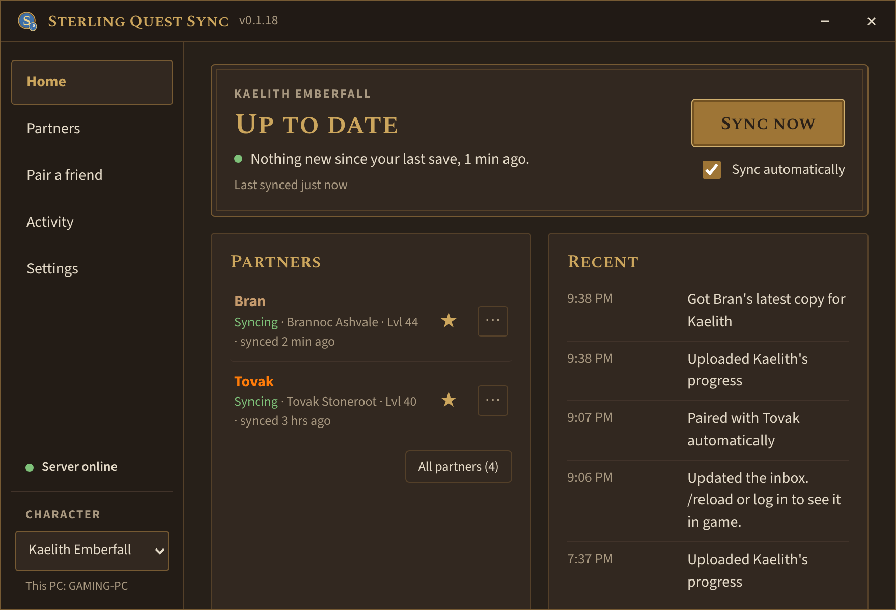
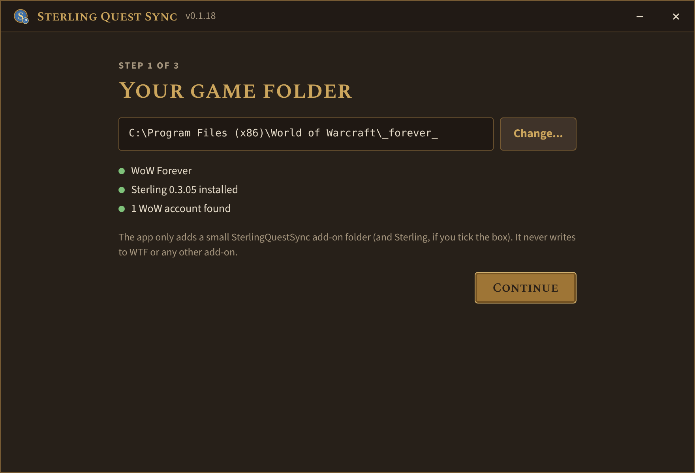
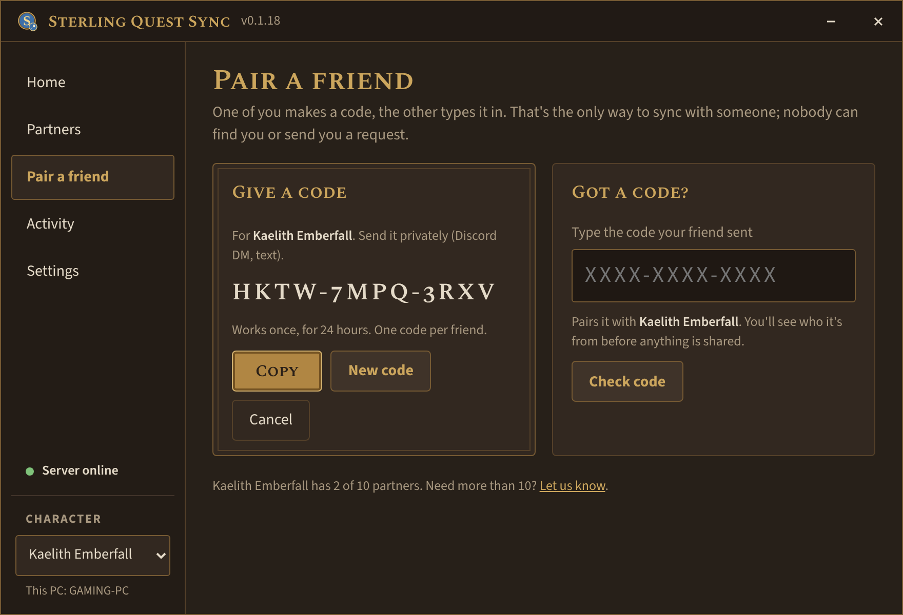

# Sterling Quest Sync

**Status:** Still in heavy development and not finished yet. Things are mostly settled now, but big changes can still come with an update.

Sterling began as a little project for me and a few close friends, so we could keep our quests in step while we adventure together, even with different schedules. It's been a lot of fun to build, so I'm sharing it here in case anyone else finds it useful. It's shaped by how we like to play, and it gets updates whenever I can find the time. Ideas and bug reports are always welcome.

> Built by Kael with the help of Claude Opus, an AI model by Anthropic. The ideas, testing and decisions are mine; much of the code was written with Claude. Everything is tested in game with friends.

<p align="center">
  
  
</p>

## What it does

[Sterling Quest Tracker](https://github.com/SterlingAddons/SterlingQuest) already syncs quests live with friends who are online at the same time. This small desktop app covers the rest: when your play times don't overlap, it uploads your latest copy when you log off, and your friend's app has it waiting before they log in.

- **Syncs on its own.** It notices when the game saves, uploads, and writes what your friends sent into a small add-on. `/reload` or log in to see it.
- **Pairs on its own.** Friends who are already Sterling partners pair in the app by themselves the next time you're both online. No codes to type.
- **Or pair with a code.** One of you makes a code, the other types it in. Nobody can find you or send you a request.
- **Favourites.** Star up to 5 partners. They stay on top in the app and in game, and starring in one shows up in the other.
- **Keeps Sterling up to date** if you want it to (Settings), and tells you in game when the app has an update.
- **Stays out of the way.** Lives in the tray, works in the background at low priority.

Works with WoW Forever. Other WoW versions may work but aren't tested.

## Get it

1. Download the newest `SterlingQuestSync_<version>_x64-setup.exe` from [Releases](https://github.com/SterlingAddons/SterlingQuestSync-App/releases/latest).
2. Run it. Windows may show "Windows protected your PC" because the app isn't signed by a paid certificate. Click **More info**, then **Run anyway**.
3. The app finds your WoW folder, offers to install Sterling if it's missing, and makes your account. No email or password.
4. Log in to the game once with Sterling running, so your character shows up.

The app updates itself after that (it asks first, unless you turn on automatic updates). Updates are signed, and the app checks the signature before installing.

**Windows:** tested. **Mac and Linux:** not built yet.

<p align="center">
  
  
</p>

## What it can touch on your PC

Hard-coded, not settings, and covered by tests that run on Windows with every build:

- It writes only to its own add-on folder (`Interface\AddOns\SterlingQuestSync`), to `Interface\AddOns\Sterling` during a Sterling update, and to its own data folder.
- **The game's `WTF` folder is read-only.** The app reads one small save file there and copies Sterling's saves into its own backups. It never writes, moves or deletes anything in WTF, even through links, junctions, short names or odd spellings.
- It never touches any other add-on. An old Sterling is moved aside on update, never deleted.
- The in-game inbox is built from a fixed template, and every value is checked before it's written, so nothing from the server can run as code in your game.

## Privacy

Your quest log, finished quests, character name and realm go to the sync server, and only reach friends you paired with. No email, password, IP address or WoW account name is stored. **Delete my data** in Settings removes everything right away. Full details are in the [server's privacy section](https://github.com/SterlingAddons/SterlingQuestSync-Server#privacy).

## Problems, abuse and security

- **Bugs and ideas:** [open an issue](https://github.com/SterlingAddons/SterlingQuestSync-App/issues/new/choose).
- **Someone misusing the app:** use the **Report abuse** form, or email support@sterlingaddons.com to keep it private.
- **Security problems:** please report privately. See [SECURITY.md](SECURITY.md).

## Related

- [Sterling Quest Tracker](https://github.com/SterlingAddons/SterlingQuest): the add-on this app works with.
- [Sterling Quest Sync server](https://github.com/SterlingAddons/SterlingQuestSync-Server): the server, with a guide to run your own.

## Building it yourself

You need Rust and Node.js.

```sh
cargo test --workspace                          # core and app tests
npx @tauri-apps/cli@2.12.4 build                # the Windows installer, from the app folder
```

- `core/`: everything except the window (file safety, save reader, inbox writer, sync engine, server client, Sterling updater).
- `app/`: the window and the commands the page may call. The page has no file, shell or network access of its own.
- `app/companion/`: the tiny `SterlingQuestSync` add-on the app installs.

## License

MIT. See [LICENSE](LICENSE).
